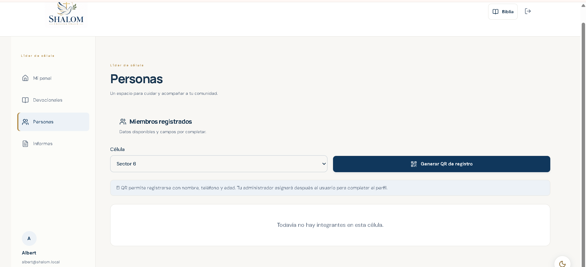

# Publicación en Vercel con Neon

La aplicación ya no depende de Cloudflare D1: usa `DATABASE_URL` y PostgreSQL.

## 1. Configura Neon

En Neon, abre **Connect** y copia la cadena con *Connection pooling* activado (el host contiene `-pooler`). En Vercel, no la guardes en Git ni la pegues en el código.

## 2. Variables en Vercel

En **Project → Settings → Environment Variables**, agrega los nombres de `env/.env.example`:

- `DATABASE_URL`: cadena pooled de Neon.
- `APP_URL`: URL pública estable de producción, por ejemplo `https://tu-dominio-principal`. Se usa como base de los QR; no configures aquí un dominio de preview o deployment.
- `CLOUDINARY_CLOUD_NAME`, `CLOUDINARY_API_KEY`, `CLOUDINARY_API_SECRET`: valores de Cloudinary.
- `NARRATION_ORIGIN`: URL HTTPS donde estén publicados los WAV, con la estructura
  `audio/LIBRO/CAPITULO.wav`. Para producción se recomienda un almacenamiento público
  como Vercel Blob. Si no se configura, la Biblia usa automáticamente la voz en español
  disponible en el teléfono o navegador.

Selecciona **Production**, **Preview** y **Development** para `DATABASE_URL` y las variables de Cloudinary. Las claves nunca deben comenzar por `NEXT_PUBLIC_`.

## 3. Crea las tablas de Neon

En tu PC, crea temporalmente `.env.local` en la raíz con `DATABASE_URL` y ejecuta:

```powershell
npm.cmd install
npm.cmd run db:push
```

No ejecutes ese comando hasta haber puesto una URL válida. Crea las tablas `church`, `accounts`, `credentials`, `sessions`, `invites`, `attempts`, `devotions` y `study` en Neon.

Las columnas `sessions.expires` e `invites.expires` guardan fechas Unix en milisegundos y deben ser `BIGINT`. Si las tablas ya se crearon con `INTEGER`, ejecuta una vez en Neon SQL Editor:

```sql
ALTER TABLE sessions ALTER COLUMN expires TYPE BIGINT;
ALTER TABLE invites ALTER COLUMN expires TYPE BIGINT;
```

## 4. Despliega

1. Sube estos cambios a `main` con Git.
2. En Vercel elige **Add New → Project**, importa `cht212/Shalom` y deja el framework como **Next.js**.
3. Vercel ejecutará `npm run build` y publicará la aplicación.
4. Prueba inicio de sesión, registro por QR, panel y gestión de cuentas en la URL de producción.

## Crear las primeras cuentas

La base de datos no crea usuarios automáticamente. Si Neon todavía no tiene cuentas, puedes crear el administrador principal y los dos líderes de célula del Sector 6 desde una terminal Windows, apuntando el script a la misma base Neon de producción:

1. En la raíz del proyecto, crea temporalmente `.env.local` con `DATABASE_URL` de Neon. No publiques ni compartas ese archivo.
2. Ejecuta `npm.cmd run provision:neon` y confirma escribiendo `PROVISIONAR CUENTAS SHALOM EN NEON`.
3. El script se detiene si ya existe cualquier cuenta. Si la base está vacía, crea `admin.shalom` como administrador principal y `albert` y `jenni` como líderes de la célula Sector 6.
4. Copia las contraseñas aleatorias que imprime y guárdalas en un gestor de contraseñas. No se guardan en el proyecto. Elimina `.env.local` al terminar.

Este paso escribe directamente en Neon; no hace falta desplegar el proyecto ni ejecutar la aplicación localmente. El script nunca modifica una base que no sea Neon ni una base que ya tenga cuentas.

Cloudinary queda preparado mediante variables. La aplicación actual no cuenta aún con una pantalla o endpoint de carga; conectaremos esas claves al crear esa función.

## Devocional por voz

La nueva función de grabación, transcripción y adjunto opcional usa `OPENAI_API_KEY` y la tabla privada `devotion_audio`. Ver [DEVOCIONAL_VOZ.md](DEVOCIONAL_VOZ.md) para configurar la clave y aplicar la migración aditiva [db/devotional-audio.sql](db/devotional-audio.sql). No se aplica durante el build. Los audios adjuntos de esta función se guardan en Neon y no usan una URL pública de Cloudinary.
